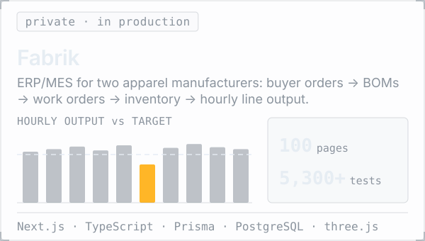
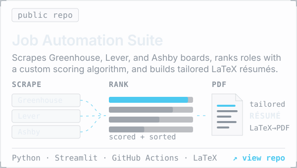
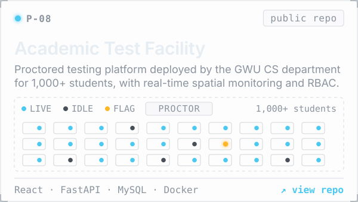

<picture>
  <source media="(prefers-color-scheme: dark)" srcset="assets/hero-dark.svg">
  <source media="(prefers-color-scheme: light)" srcset="assets/hero-light.svg">
  
</picture>

**Software Automation Controls Engineer.** I build the software layer of industrial control systems: equipment telemetry, operator HMIs, alarms, and plant data, plus the full-stack apps that operations teams run on.

- **Role:** Software Automation Controls Engineer at **SpaceXAI** (full-time from October 2026), after a Summer 2026 controls engineering internship building monitoring, analytics, and reliability tools for AI datacenter control systems
- **Education:** B.S. Computer Science, The George Washington University (2026)
- **On the side:** **Fabrik**, a production ERP/MES that runs two apparel manufacturers
- **How I work:** I use AI coding agents every day, with clear rules and human review before anything ships

 

<picture>
  <source media="(prefers-color-scheme: dark)" srcset="assets/sections/selected-work-dark.svg">
  <source media="(prefers-color-scheme: light)" srcset="assets/sections/selected-work-light.svg">
  
</picture>

  <a href="https://aguo890.github.io/#/projects/breaker-dashboard"><picture>
    <source media="(prefers-color-scheme: dark)" srcset="assets/cards/relay-fleet-telemetry-dark.svg">
    <source media="(prefers-color-scheme: light)" srcset="assets/cards/relay-fleet-telemetry-light.svg">
    
  </picture></a>
  <a href="https://aguo890.github.io/#/projects/hmi-agent-sandbox"><picture>
    <source media="(prefers-color-scheme: dark)" srcset="assets/cards/ai-agent-hmi-workflow-dark.svg">
    <source media="(prefers-color-scheme: light)" srcset="assets/cards/ai-agent-hmi-workflow-light.svg">
    
  </picture></a>

  <a href="https://aguo890.github.io/#/projects/datacenter-analytics"><picture>
    <source media="(prefers-color-scheme: dark)" srcset="assets/cards/plant-data-reliability-dark.svg">
    <source media="(prefers-color-scheme: light)" srcset="assets/cards/plant-data-reliability-light.svg">
    
  </picture></a>
  <a href="https://aguo890.github.io/#/projects/fabrik"><picture>
    <source media="(prefers-color-scheme: dark)" srcset="assets/cards/fabrik-dark.svg">
    <source media="(prefers-color-scheme: light)" srcset="assets/cards/fabrik-light.svg">
    
  </picture></a>

  <a href="https://github.com/aguo890/Job-Automation-Suite"><picture>
    <source media="(prefers-color-scheme: dark)" srcset="assets/cards/job-automation-suite-dark.svg">
    <source media="(prefers-color-scheme: light)" srcset="assets/cards/job-automation-suite-light.svg">
    
  </picture></a>
  <a href="https://github.com/aguo890/linesight"><picture>
    <source media="(prefers-color-scheme: dark)" srcset="assets/cards/linesight-dark.svg">
    <source media="(prefers-color-scheme: light)" srcset="assets/cards/linesight-light.svg">
    
  </picture></a>

  <a href="https://github.com/aguo890/tax-os"><picture>
    <source media="(prefers-color-scheme: dark)" srcset="assets/cards/lokumai-dark.svg">
    <source media="(prefers-color-scheme: light)" srcset="assets/cards/lokumai-light.svg">
    
  </picture></a>
  <a href="https://github.com/aguo890/capstone"><picture>
    <source media="(prefers-color-scheme: dark)" srcset="assets/cards/academic-test-facility-dark.svg">
    <source media="(prefers-color-scheme: light)" srcset="assets/cards/academic-test-facility-light.svg">
    
  </picture></a>

Screenshots and full write-ups for every project are on <a href="https://aguo890.github.io/#projects">aguo890.github.io</a>.

Selected work as a table (text)

| Project | What it is | Stack |
| :--- | :--- | :--- |
| **[Relay Fleet Telemetry](https://aguo890.github.io/#/projects/breaker-dashboard)**   _SpaceXAI · internal_ | Read-only telemetry for datacenter protective relays and breaker trip units: high-concurrency polling, live config capture, drift detection against design, and an event log, with every write path human-gated. | `Python` `FastAPI` `MySQL` `Modbus` `Docker` `Ansible` |
| **[AI-Agent HMI Workflow](https://aguo890.github.io/#/projects/hmi-agent-sandbox)**   _SpaceXAI · internal_ | MCP server and headless build loop for SCADA HMI development: agents write only to a sandbox gateway, views pass automated visual checks, and a human promotes them to production. | `Ignition 8.3` `ISA-101` `MCP` `Playwright` |
| **[Plant Data & Reliability Tools](https://aguo890.github.io/#/projects/datacenter-analytics)**   _SpaceXAI · internal_ | Historian-to-analytics platform with SPC charts, an OT server disk-fill early warning, offsite backups for SCADA archives, and planning tools. 6 internal tools deployed in one summer. | `Python` `TimescaleDB` `React` `Docker` |
| **[Fabrik](https://aguo890.github.io/#/projects/fabrik)**   _private · in production_ | ERP/MES for two apparel manufacturers: buyer orders → BOMs → work orders → ledgered inventory → hourly line output, plus a TV andon and a 3D floor view. Co-built with one other engineer; 100 pages and 5,300+ tests. | `Next.js` `TypeScript` `Prisma` `PostgreSQL` `three.js` |
| **[Job Automation Suite](https://github.com/aguo890/Job-Automation-Suite)**   _[screenshots](https://aguo890.github.io/#/projects/job-automation-suite)_ | Scrapes Greenhouse, Lever, and Ashby job boards, ranks roles with a custom scoring algorithm, and generates tailored LaTeX résumés in one click. | `Python` `Streamlit` `GitHub Actions` `LaTeX` |
| **[LineSight](https://github.com/aguo890/linesight)**   _[screenshots](https://aguo890.github.io/#/projects/linesight)_ | Manufacturing analytics SaaS. LLM-powered semantic ETL turns messy factory spreadsheets into dashboards without rigid templates. | `React 19` `FastAPI` `Celery` `PostgreSQL` |
| **[LokumAI](https://github.com/aguo890/tax-os)**   _[screenshots](https://aguo890.github.io/#/projects/lokumai)_ | Tax optimization for physicians, with an agentic assistant for multi-step tax reasoning and cited answers (RAG). | `TypeScript` `FastAPI` `MySQL` `Docker` |
| **[Academic Test Facility](https://github.com/aguo890/capstone)**   _[screenshots](https://aguo890.github.io/#/projects/academic-test-facility)_ | Proctored testing platform deployed by the GWU CS department and used by 1,000+ students, with real-time spatial monitoring and RBAC. | `React` `FastAPI` `MySQL` `Docker` |

 

<picture>
  <source media="(prefers-color-scheme: dark)" srcset="assets/sections/stack-dark.svg">
  <source media="(prefers-color-scheme: light)" srcset="assets/sections/stack-light.svg">
  
</picture>

<picture>
  <source media="(prefers-color-scheme: dark)" srcset="assets/stack-dark.svg">
  <source media="(prefers-color-scheme: light)" srcset="assets/stack-light.svg">
  
</picture>

Full stack inventory (text)

<!-- stack-table:start -->

| Area | Tools |
| :--- | :--- |
| **Languages** | `Python` `TypeScript` `JavaScript` `SQL` `Bash` `PowerShell` `C++ (pybind11)` `Rust` `Swift` `Java` `Kotlin` `R` `Google Apps Script` |
| **Controls & automation** | `Siemens TIA Portal` `PLC logic & datablocks` `SCADA` `Ignition 8.3 Perspective` `Ignition gateway REST API` `ISA-101 / high-performance HMI` `Alarm management` `Historians` `Telnet / terminal automation` `OT data modeling` |
| **Industrial protocols** | `Modbus TCP/RTU` `RS-485 serial gateways` `DNP3` `OPC-UA` `MQTT` `BACnet` `SNTP` `SER & COMTRADE` |
| **Electrical & power** | `Protective relays (SEL)` `LV breaker trip units (LSIG)` `Time-current curves` `CT/PT ratio math` `One-lines & schematics` `MV/LV switchgear` `UPS` `CDUs` `PoE signal towers` |
| **Backend & data** | `FastAPI` `Flask` `Node.js` `PostgreSQL` `TimescaleDB` `MySQL 8` `SQLite` `Prisma` `SQLAlchemy` `PyMySQL` `Alembic` `Redis` `Celery` `REST` `SSE` `WebSockets` `Job orchestration (leases, scheduling)` |
| **Frontend** | `React` `Next.js` `Vite` `Tailwind CSS` `three.js` `ECharts` `Recharts` `Chart.js` `Zustand` `Orval` `Streamlit` `next-intl (EN/AR)` `SVG rendering` `Vanilla JS/CSS` `SwiftUI` `Apple Metal` |
| **Data & analytics** | `Pandas` `NumPy` `PySpark` `SPC` `Time-series forecasting` `R (dplyr, tidyr)` `Tableau` `Power BI` |
| **Infra & DevOps** | `Docker / Docker Compose` `Ansible` `systemd` `Linux VMs` `Proxmox` `Nginx` `Tailscale` `GitHub Actions` `Makefile` `AWS (Lambda, SNS)` `Google Cloud (GCS, IAM)` `WinRM` `Backup & DR` `OT networking` |
| **Auth & security** | `Okta OIDC` `JWT` `SSO / RBAC` `LDAP` `Audit logging` `Load & security testing` |
| **Testing & quality** | `pytest` `Vitest` `Playwright` `ruff` `mypy` |
| **AI & agents** | `MCP servers` `Agent skills` `Agentic coding workflows` `AGENTS.md doc frameworks` `LLM orchestration` `RAG` `OpenAI API` `DeepSeek` `ElevenLabs` |
| **Spoken** | `English (native)` `Mandarin (fluent)` |

<!-- stack-table:end -->

 

<picture>
  <source media="(prefers-color-scheme: dark)" srcset="assets/sections/github-stats-dark.svg">
  <source media="(prefers-color-scheme: light)" srcset="assets/sections/github-stats-light.svg">
  
</picture>

  <picture>
    <source media="(prefers-color-scheme: dark)" srcset="https://github-readme-stats.vercel.app/api?username=aguo890&show_icons=true&include_all_commits=true&count_private=true&hide_border=true&bg_color=00000000&title_color=E6EDF3&text_color=8B949E&icon_color=4CC9F0&ring_color=4CC9F0">
    <source media="(prefers-color-scheme: light)" srcset="https://github-readme-stats.vercel.app/api?username=aguo890&show_icons=true&include_all_commits=true&count_private=true&hide_border=true&bg_color=00000000&title_color=1F2328&text_color=59636E&icon_color=0A7AA8&ring_color=0A7AA8">
    
  </picture>
  <picture>
    <source media="(prefers-color-scheme: dark)" srcset="https://github-readme-stats.vercel.app/api/top-langs/?username=aguo890&layout=compact&langs_count=8&hide_border=true&bg_color=00000000&title_color=E6EDF3&text_color=8B949E">
    <source media="(prefers-color-scheme: light)" srcset="https://github-readme-stats.vercel.app/api/top-langs/?username=aguo890&layout=compact&langs_count=8&hide_border=true&bg_color=00000000&title_color=1F2328&text_color=59636E">
    
  </picture>

  <picture>
    <source media="(prefers-color-scheme: dark)" srcset="https://github-readme-streak-stats.herokuapp.com/?user=aguo890&hide_border=true&background=00000000&stroke=30363D&ring=4CC9F0&fire=FFB627&currStreakNum=E6EDF3&sideNums=E6EDF3&currStreakLabel=4CC9F0&sideLabels=8B949E&dates=8B949E">
    <source media="(prefers-color-scheme: light)" srcset="https://github-readme-streak-stats.herokuapp.com/?user=aguo890&hide_border=true&background=00000000&stroke=D1D9E0&ring=0A7AA8&fire=9A6700&currStreakNum=1F2328&sideNums=1F2328&currStreakLabel=0A7AA8&sideLabels=59636E&dates=59636E">
    
  </picture>

 

<picture>
  <source media="(prefers-color-scheme: dark)" srcset="assets/sections/contact-dark.svg">
  <source media="(prefers-color-scheme: light)" srcset="assets/sections/contact-light.svg">
  
</picture>

  <a href="https://www.linkedin.com/in/guo-aaron/"><picture>
    <source media="(prefers-color-scheme: dark)" srcset="assets/contact/linkedin-dark.svg">
    <source media="(prefers-color-scheme: light)" srcset="assets/contact/linkedin-light.svg">
    
  </picture></a>
  <a href="mailto:compsci.aaron.guo@gmail.com"><picture>
    <source media="(prefers-color-scheme: dark)" srcset="assets/contact/email-dark.svg">
    <source media="(prefers-color-scheme: light)" srcset="assets/contact/email-light.svg">
    
  </picture></a>
  <a href="https://aguo890.github.io/"><picture>
    <source media="(prefers-color-scheme: dark)" srcset="assets/contact/portfolio-dark.svg">
    <source media="(prefers-color-scheme: light)" srcset="assets/contact/portfolio-light.svg">
    
  </picture></a>

  <a href="https://www.linkedin.com/in/guo-aaron/">linkedin.com/in/guo-aaron</a> · <a href="mailto:compsci.aaron.guo@gmail.com">compsci.aaron.guo@gmail.com</a> · <a href="https://aguo890.github.io/">aguo890.github.io</a>

